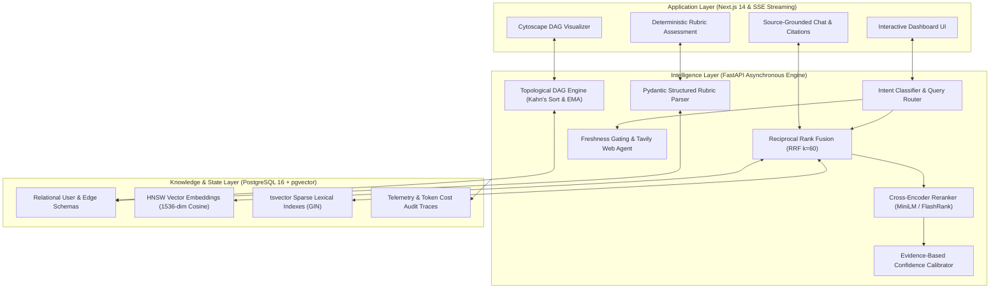
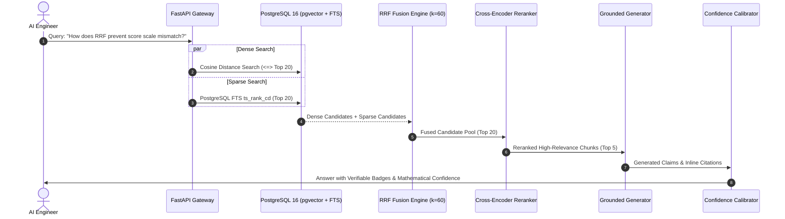
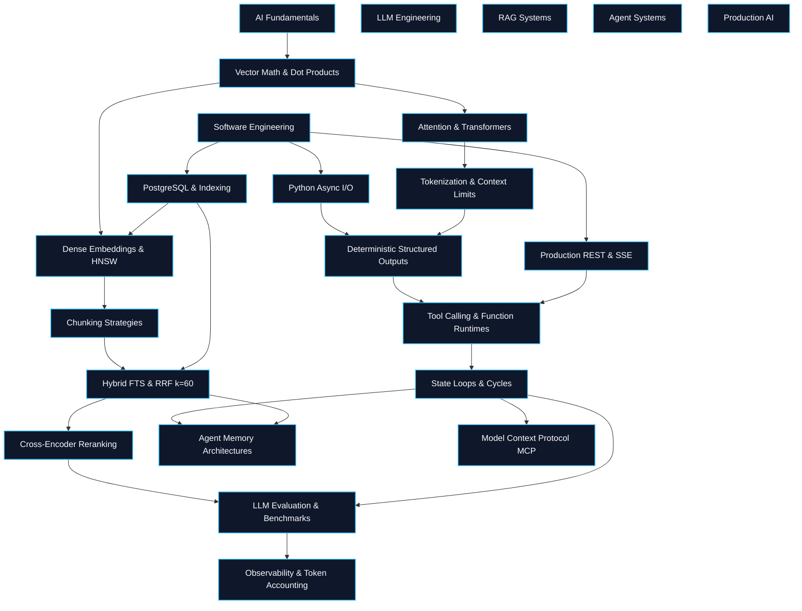

<div align="center">

# ⚡ ImpeccableOS
### Adaptive AI Engineering Trainer & Execution Engine

<p align="center">
  <strong>An enterprise-grade, mathematically calibrated learning runtime for modern AI engineers.</strong><br/>
  Engineered with deterministic DAG state transitions, hybrid dense-sparse retrieval (RRF <em>k=60</em>),<br/>
  multi-factor confidence calibration, and freshness-gated autonomous web research.
</p>

<p align="center">
  
  
  
  
  
  
  
  
</p>

</div>

---

<div align="center">
  <h2>📐 System Architecture & Topology</h2>
</div>

ImpeccableOS decouples client presentation, probabilistic LLM reasoning, deterministic state transitions, and persistent storage into three isolated tiers:



---

<div align="center">
  <h2>🔬 Core Engineering Innovations</h2>
</div>

### 1. Deterministic State Engine vs. LLM-Based Mutation
Direct LLM state assignment (*"Grade this answer 0-100 and update database"*) suffers from prompt injection, prompt drift, and irreproducible mastery jumps. ImpeccableOS enforces strict separation:
1. **Probabilistic Analysis Pass:** The LLM functions strictly as a grammar-constrained parser returning Pydantic boolean criteria.
2. **Deterministic State Mutation:** A native Python engine computes objective scores and applies an **Exponential Moving Average (EMA)**:

$$\Large M_t = \alpha \cdot \text{Score}_t + (1 - \alpha) \cdot M_{t-1}$$

Where $\alpha = 0.30$. Mastery unlocks downstream DAG dependencies only when $M_t \ge 0.70$.

---

### 2. Two-Stage Hybrid Retrieval with Reciprocal Rank Fusion (RRF)
Vector embeddings compress subtle syntactic distinctions, failing on exact technical tokens (e.g., parameter flags, version tags, acronyms). ImpeccableOS combines PostgreSQL full-text search (`tsvector` with `ts_rank_cd`) and dense vector search (`pgvector` HNSW cosine distance) via **Reciprocal Rank Fusion**:

$$\Large RRF(d) = \sum_{m \in M} \frac{1}{k + r_m(d)}$$

Where $k = 60$. The top 20 candidate documents are then reranked through a cross-encoder model to surface the top 3-5 context chunks.



---

### 3. Objective Evidence-Based Confidence Calibration
Rather than soliciting hallucinated model self-confidence (*"I am 95% confident"*), ImpeccableOS calculates confidence externally as an objective mathematical property of the grounding evidence:

$$\Large \text{Confidence} = 0.35 \cdot S_{\text{retrieval}} + 0.25 \cdot S_{\text{authority}} + 0.40 \cdot S_{\text{claim\_support}} - P_{\text{staleness}}$$

- $S_{\text{retrieval}}$: Mean normalized cross-encoder score across context passages.
- $S_{\text{authority}}$: Authority hierarchy weight (Tier 1 Specs: $1.0$, Tier 2 Maintainer Blogs: $0.8$, Tier 3 Community: $0.5$).
- $S_{\text{claim\_support}}$: Ratio of generated assertions validated by explicit text span citations.
- $P_{\text{staleness}}$: Recency penalty applied when framework specifications have undergone breaking updates.

---

### 4. Freshness-Gated Web Research
Autonomous web retrieval carries high latency ($8\text{s}+$) and token overhead. ImpeccableOS protects the sub-second static RAG budget via a deterministic classifier:
- **Stable Foundational Concepts:** (e.g. *Backpropagation*, *Transformer Attention*) are strictly resolved via the static verified corpus.
- **Dynamic Research Triggered Only If:**
  1. The query contains explicit temporal keywords (`latest`, `release notes`, `v0.x`, `2026`).
  2. The static RAG reranker score falls below $0.50$ on rapidly evolving framework topics.

---

<div align="center">
  <h2>🗺️ AI Engineering Skill Graph Taxonomy</h2>
</div>

The knowledge architecture models prerequisite dependencies across five core disciplines:



---

<div align="center">
  <h2>📂 Monorepo Structure</h2>
</div>

```
ImpeccableOS/
├── .github/
│   └── workflows/
│       └── ci.yml               # Automated CI (Pytest, Unittest, Next.js Build)
├── apps/
│   ├── api/                     # FastAPI Asynchronous Backend
│   │   ├── src/
│   │   │   ├── api/v1/          # Endpoints (auth, dag, roadmap, chat, assessment)
│   │   │   ├── core/            # Config, Async SQLAlchemy Database, Telemetry
│   │   │   ├── models/          # ORM Models (User, SkillNode, DocumentChunk)
│   │   │   ├── schemas/         # Pydantic Schemas for Requests & Rubrics
│   │   │   ├── services/        # DAGEngine, HybridController, Calibrator, Freshness
│   │   │   └── main.py          # FastAPI Application Entrypoint
│   │   ├── tests/               # Algorithmic & Integration Test Suite
│   │   ├── Dockerfile
│   │   └── requirements.txt
│   └── web/                     # Next.js 14 App Router Frontend
│       ├── src/
│       │   ├── app/             # Modern Dashboard Pages & Layouts
│       │   ├── components/      # DagVisualizer, GroundedChat, ConfidenceMeter
│       │   └── lib/             # Typed API Client & Domain Contracts
│       ├── tailwind.config.ts
│       ├── package.json
│       └── Dockerfile
├── data/
│   ├── corpus/                  # Curated AI Engineering Technical Corpus
│   └── seed/                    # Skill Graph Taxonomy Definitions
├── docs/
│   ├── adr/                     # Architectural Decision Records (001 - 006)
│   └── spec/                    # Domain Specification & System Topology
├── scripts/
│   └── seed_database.py         # Automated PostgreSQL + pgvector Seeding Script
├── .env.example                 # Environment Blueprint
├── .gitignore                   # Enterprise Monorepo Git Ignore
├── docker-compose.yml           # Multi-Container Compose Configuration
├── Makefile                     # Developer Command Automation
├── package.json                 # Monorepo Workspace Configuration
└── README.md                    # Project Documentation
```

---

<div align="center">
  <h2>🚀 Quickstart & Setup Guide</h2>
</div>

### Prerequisites
- [Docker](https://www.docker.com/) & Docker Compose
- Node.js $\ge 20$
- Python $\ge 3.11$

### Option 1: One-Click Launch via Docker Compose (Recommended)
```bash
# 1. Clone repository
git clone https://github.com/sourabhsk0007/ImpeccableOS.git
cd ImpeccableOS

# 2. Configure environment
cp .env.example .env

# 3. Spin up PostgreSQL 16 (pgvector), FastAPI Intelligence Layer & Next.js Web
docker compose up -d

# 4. Seed database taxonomy and reference corpus
docker compose exec api python scripts/seed_database.py
```
- **Web Dashboard:** [http://localhost:3000](http://localhost:3000)
- **FastAPI Interactive Docs:** [http://localhost:8000/docs](http://localhost:8000/docs)

---

### Option 2: Local Developer Environment

#### Backend (FastAPI)
```bash
cd apps/api
python -m venv .venv
# On Windows:
.venv\Scripts\activate
# On Linux/macOS:
source .venv/bin/activate

pip install -r requirements.txt
uvicorn src.main:app --reload --port 8000
```

#### Frontend (Next.js 14)
```bash
cd apps/web
npm install
npm run dev
```

#### Automated Verification Suite
```bash
# Run core algorithmic tests (DAG cycle checks, EMA math, RRF scoring)
python -m unittest apps/api/tests/test_core_algorithms.py

# Run full pytest test suite
cd apps/api && pytest -v
```

---

<div align="center">
  <h2>📡 REST API Specification</h2>
</div>

| Method | Endpoint | Description | Key Parameters / Schemas |
| :--- | :--- | :--- | :--- |
| `GET` | `/api/v1/health` | System health check and runtime status | Service name, version, environment |
| `GET` | `/api/v1/dag/graph` | Complete DAG topology for Cytoscape UI | Vertices, directed edges, thresholds |
| `GET` | `/api/v1/dag/skills/{id}` | Detailed metadata & rubric thresholds for a skill | Depth, prerequisites, criteria |
| `GET` | `/api/v1/roadmap/user-roadmap` | Dynamic topological roadmap calculated for user | `target_career_path`, completion rate |
| `POST` | `/api/v1/retrieval/search` | Two-stage hybrid RRF search (pgvector + FTS) | `query`, `top_k`, `force_web_search` |
| `POST` | `/api/v1/chat/completions` | Grounded chat completion with inline citations | `message`, `conversation_history` |
| `POST` | `/api/v1/assessment/submit` | Deterministic rubric evaluation & EMA update | `skill_id`, `user_code_or_answer` |
| `POST` | `/api/v1/research/query` | Targeted autonomous web research via Tavily | `query`, `max_results` |

---

<div align="center">
  <h2>📜 Architectural Decision Records (ADRs)</h2>
</div>

| ADR | Title | Decision Summary |
| :--- | :--- | :--- |
| [ADR 001](file:///docs/adr/0001-unified-database-postgresql-pgvector.md) | **Unified PostgreSQL + pgvector Database** | Single database engine for relational state and HNSW vector similarity search to guarantee ACID consistency. |
| [ADR 002](file:///docs/adr/0002-deterministic-state-engine-vs-llm.md) | **Deterministic State Engine vs. LLM Mutation** | LLM constrained to structured Pydantic boolean extraction; Python engine executes EMA math to eliminate prompt injections. |
| [ADR 003](file:///docs/adr/0003-hybrid-retrieval-rrf-cross-encoder.md) | **Hybrid Retrieval with Reciprocal Rank Fusion** | Combines pgvector cosine search and PostgreSQL FTS tsvector using RRF ($k=60$) followed by cross-encoder reranking. |
| [ADR 004](file:///docs/adr/0004-evidence-based-confidence-calibration.md) | **Evidence-Based Confidence Calibration** | Confidence computed externally from retrieval relevance, source authority, and claim support ratios. |
| [ADR 005](file:///docs/adr/0005-single-agent-tool-execution.md) | **Single-Agent Tool Execution Before Multi-Agent** | Deterministic function-calling runtime with structured traces prior to multi-agent delegation topology. |
| [ADR 006](file:///docs/adr/0006-web-research-gating-freshness.md) | **Web Research Gating via Freshness Triggers** | Deterministic gating restricts web search to temporal queries and evolving topic fallbacks ($<0.50$ score). |

---

<div align="center">
  <p>Crafted for production-grade engineering standards.</p>
  <p>© 2026 ImpeccableOS. Released under the MIT License.</p>
</div>
